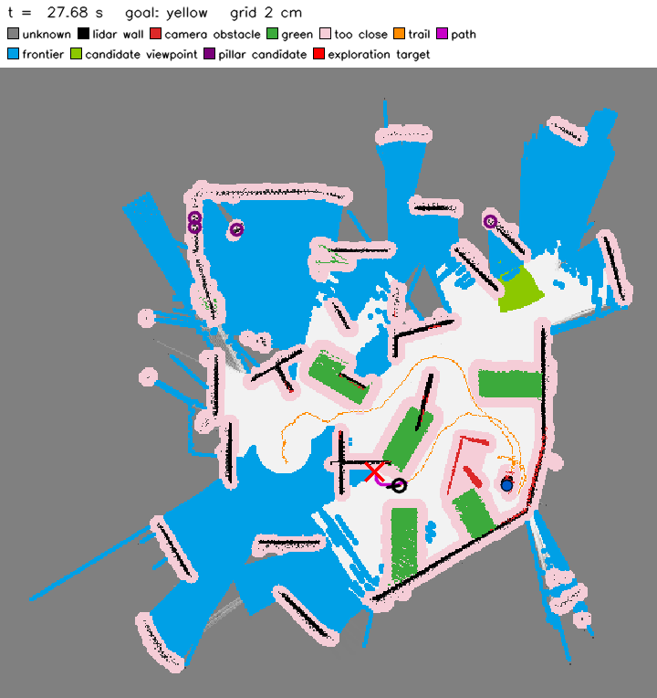
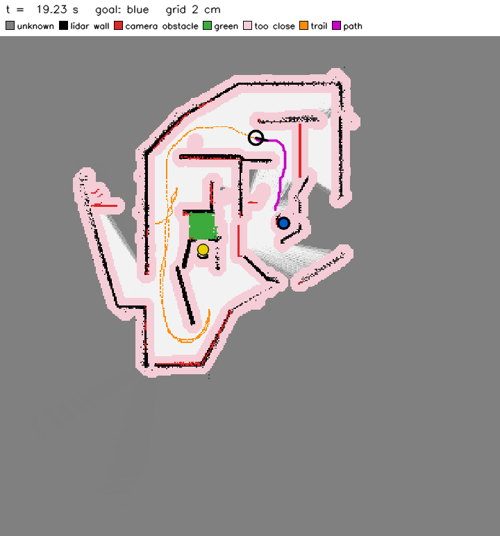
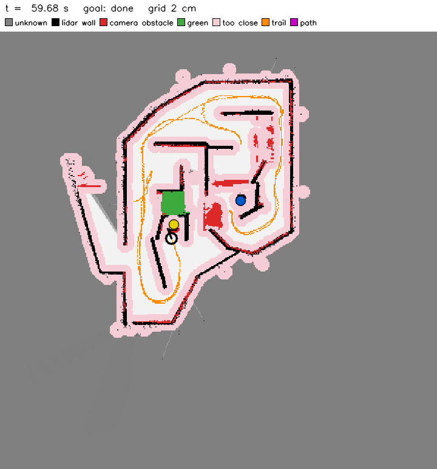

# How the Rosbot navigator works: a study guide

This guide explains the code in `navigator/` from the ground up, so that every group member can explain
the approach in the meeting after the deadline. Each section first gives the idea, then shows where it lives
in the code and which numbers it uses. The exercises at the end let you test yourself.

Suggested order: read sections 1 to 4 once, then section 5 (the occupancy grid) carefully, because almost
everything else reads from or writes to the grid. Keep the live map window open while you read (section 12).

---

## Contents

1. [The task and what it forces on the design](#1-the-task-and-what-it-forces-on-the-design)
2. [The robot's sensors](#2-the-robots-sensors)
3. [The main loop](#3-the-main-loop)
4. [Coordinates and the grid](#4-coordinates-and-the-grid)
5. [The occupancy grid](#5-the-occupancy-grid)
6. [Where am I? Odometry, de-skew and scan matching](#6-where-am-i-odometry-de-skew-and-scan-matching)
7. [Perception: green floor, floating walls, pillars](#7-perception-green-floor-floating-walls-pillars)
8. [Planning: cost map and shortest path](#8-planning-cost-map-and-shortest-path)
9. [Exploration: where to go when the pillar is unknown](#9-exploration-where-to-go-when-the-pillar-is-unknown)
10. [Control: pure pursuit and speed limits](#10-control-pure-pursuit-and-speed-limits)
11. [Behaviour: goals, "reached", getting unstuck](#11-behaviour-goals-reached-getting-unstuck)
12. [Running it and reading the live map window](#12-running-it-and-reading-the-live-map-window)
13. [Parameters](#13-parameters)
14. [Exercises](#14-exercises)
15. [Glossary](#15-glossary)
16. [Further reading](#16-further-reading)

---

## 1. The task and what it forces on the design

From the Modularbeit sheet: drive the Rosbot from its start to the **blue** pillar, then to the **yellow**
pillar, in as little *simulation* time as possible; never drive over **green** floor; the mazes contain
narrow passages, passages that are too narrow, and **floating walls**; one codebase for all mazes; **no
Webots Supervisor**; the robot and the worlds must not be changed.

| Rule | Consequence for the design |
|---|---|
| No Supervisor | The robot never knows its true position or the maze layout. It must build its own map and estimate its own position: this is **SLAM** (simultaneous localisation and mapping) in a simple form. |
| Pillar positions unknown | When the goal pillar is not yet seen, the robot must **explore**. |
| Floating walls | The lidar scans a single horizontal plane 13 cm above the floor. A board floating above that plane is invisible to it, so the **depth camera** must find it. |
| Green floor | Only the **colour camera** can see green. It is drawn into the map as a forbidden area. |
| Too-narrow passages | The planner must know the robot's size and refuse gaps it does not fit through. |
| Shortest time | Drive fast where the way is known to be clear, slowly where it is not. |
| One codebase | All numbers live in `navigator/params.py`; a maze may only change values, never code paths. |

---

## 2. The robot's sensors

All device names come from the top of `navigator/navigator.py` ("devices" block).

| Device | What it measures | Blind spots | Used for |
|---|---|---|---|
| `laser` (RpLidar A2) | 400 distances around the robot, 12 sweeps per second, in one plane 0.131 m above the floor | closer than 0.2 m; anything above or below its plane | walls in the map, scan matching, pillar distance |
| `camera depth` | distance per pixel | closer than 0.6 m | floating and low walls, "is the floor ahead really free" |
| `camera rgb` | colour image | no distance by itself | green floor, pillar colour, near wooden slabs |
| `imu inertial_unit` | roll, pitch, yaw | none here (no drift in this simulation) | heading, tilt detection |
| wheel encoders (4) | wheel angles | slip | distance travelled |
| `fl_range`, `fr_range` (infra-red) | short distance at the front | far away | the lidar's 20 cm blind zone |
| wheel motors (4) | (actuators) | | driving: the code sends a wheel speed |

A key idea: **no sensor sees everything**, so the map combines several of them. Each one fills in what
another one misses.

---

## 3. The main loop

Webots calls the controller in fixed steps (`robot.step(DT_MS)`, the world's basic time step). The bottom of
`navigator.py` runs:

```
while robot.step(DT_MS) != -1:
    step_once()          # one full sense -> think -> act cycle
    view.update(...)     # live map window (display only)
    status line / snapshot to the log file
```

`step_once()` is long but follows a fixed order. Its section comments (`# ---- odometry`, `# ---- lidar
mapping`, ...) match the boxes below:

```
           +-----------------------------------------------------------+
 sensors ->| 1 odometry      IMU yaw + wheel encoders -> pose (x, y, th)|
           | 2 lidar mapping de-skew, scan match (fix pose), update grid|
           | 3 infra-red     close obstacles in front -> grid           |
           | 4 cameras       green floor, depth obstacles, pillars      |
           | 5 goal handling reached the current pillar?                |
           | 6 look around   spin once if the goal pillar is unknown    |
           | 7 planning      every 0.25 s: cost map + shortest path     |
           | 8 reflexes      tilting? stuck? -> back off                |
           | 9 control       pure pursuit -> (v, w) -> wheel speeds     |-> motors
           +-----------------------------------------------------------+
```

The modules:

| File | Role |
|---|---|
| `navigator.py` | the loop above, the decision logic, logging |
| `params.py` | every tunable number, plus per-maze overrides |
| `grid.py` | **the occupancy grid and its extra layers** |
| `lidar_deskew.py` | gives each lidar beam the robot pose at the moment it was measured |
| `localize.py` | scan matching (`ScanMatcher`) and wheel-slip check (`SlipCheck`) |
| `perception.py` | turns pixels and beams into points in the robot frame |
| `planner.py` | cost map, shortest path, exploration targets |
| `control.py` | pure-pursuit path follower and wheel speeds |
| `map_view.py` | the live map window (display only) |

---

## 4. Coordinates and the grid

**Frames.** There are two coordinate frames:

- **robot frame:** x forward, y to the left, origin at the robot centre. Sensors report in this frame.
- **world frame:** fixed. Its origin is where the robot *started*, and x points the way it first faced.

`to_world(pose, xr, yr)` in `navigator.py` rotates and shifts robot-frame points into the world frame
using the pose `(x, y, θ)`:

```
x_w = x + cos θ · x_r − sin θ · y_r
y_w = y + sin θ · x_r + cos θ · y_r
```

**The grid.** The world is cut into square cells of `res = 0.02` m (2 cm). The map is `size = 16` m
across, so it has 800 × 800 cells, with the start in the middle cell (`off = 400`). In `grid.py`:

```python
def cell(self, x, y):        # world metres -> (row, col)
    return floor(y / res) + off, floor(x / res) + off
def xy(self, r, c):          # (row, col) -> world metres of the cell centre
    return (c - off + 0.5) * res, (r - off + 0.5) * res
```

**Row = y, column = x.** This is easy to mix up. Row 0 is the lowest y, so to draw the map with north
up, `map_view.py` flips the image (`img[::-1]`).

Why 2 cm? The walls are 5 cm boards and the tightest passable gaps leave only a few centimetres on each side
of the robot. With bigger cells, those gaps would round off to "closed".

---

## 5. The occupancy grid

### 5.1 The idea

An **occupancy grid** stores, for every cell, the probability that something occupies it. At the start all
cells are unknown (p = 0.5). Each lidar beam tells us two things:

1. the cells the beam **passed through** are probably **free**;
2. the cell where it **stopped** (the hit) is probably **occupied**.

One beam alone is not trusted: sensors are noisy and the pose estimate is a little off. Evidence is
therefore *accumulated* over many scans, so a cell becomes "wall" only after enough hits.

### 5.2 Log-odds: why we add instead of multiply

Combining evidence with Bayes' rule means multiplying probabilities, which is clumsy and numerically awkward.
The standard trick (Thrun, Burgard and Fox, *Probabilistic Robotics*, ch. 9) is to store the **log-odds**

$$ l = \ln\frac{p}{1-p} \qquad\Longleftrightarrow\qquad p = \frac{1}{1+e^{-l}} $$

With log-odds, the Bayes update becomes a plain **addition**: each observation adds a fixed amount.

| p | 0.05 | 0.27 | 0.41 | **0.5** | 0.67 | 0.71 | 0.82 | 0.99 |
|---|---|---|---|---|---|---|---|---|
| l | −3 | −1 | −0.35 | **0** (unknown) | 0.7 | 0.9 | 1.5 | 5 |

### 5.3 The numbers in this code (`params.py`)

| Parameter | Value | Meaning |
|---|---|---|
| `l_hit` | +0.9 | added to the cell where a beam ended (p 0.5 → 0.71 after one hit) |
| `l_free` | −0.35 | added to each cell a beam passed through |
| `l_min`, `l_max` | −3, +5 | clamp (see below) |
| `l_occ` | 0.7 | above this a cell counts as **wall** |
| `l_sticky` | 1.5 | above this a wall is **confirmed** and hard to erase |
| `sticky_clear` | 0.1 | free evidence on confirmed walls is scaled by this |
| `free_stop` | 0.06 m | free marking stops this far before the hit |
| `lidar_max_use` | 5.0 m | returns further away are ignored |

What these mean in practice:

- A single hit (0.9 > 0.7) already makes a cell a wall, so the robot reacts fast to new walls.
- A single free ray afterwards (0.9 − 0.35 = 0.55 < 0.7) removes it again, so one-off noise disappears.
- Two hits (1.8 > 1.5) make a wall **sticky**. After that, a free ray only subtracts 0.035, so it takes
  dozens of rays to erase it. This matters because a ray that *grazes* a 5 cm board at a shallow angle often
  "passes through" the board's cells in the grid and would otherwise wipe the wall out.
- **Clamping** to [−3, 5] keeps the grid able to change its mind. Without it, a cell seen free a thousand
  times could never become a wall, even after a door closed.

### 5.4 The update, line by line (`Grid.update_lidar`)

The inputs are arrays with one entry per beam: origins `ox, oy` (the lidar position when that beam was
measured, see de-skew in section 6), world angles `a`, and ranges `rng`.

```python
step = res * 0.9                                      # sample every 1.8 cm along each ray
k = arange(nmax) * step                               # distances along the ray
free_len = min(rng, lidar_max_use) - free_stop        # stop 6 cm before the hit
fx = ox[:, None] + cos(a)[:, None] * k[None, :]       # all sample points of all rays at once
fy = oy[:, None] + sin(a)[:, None] * k[None, :]
m  = k[None, :] < free_len[:, None]                   # keep samples before the hit
lin = unique(row * n + col)                           # each free cell once per scan
logodds[lin] += l_free  (or sticky_clear * l_free on confirmed walls)
...
logodds[hit cells] += l_hit
clip(logodds, l_min, l_max)
```

Points to notice:

- **Ray casting by sampling.** The textbook way to find the cells a ray crosses is Bresenham's line
  algorithm. Here every ray is instead sampled every 1.8 cm, which is smaller than a cell, so no cell is
  skipped. NumPy then handles all 400 rays in one go, without a Python loop per ray.
- **`np.unique`.** A cell crossed by many rays in the same scan is updated only once per scan, so near
  cells do not pile up evidence faster than far ones.
- **`free_stop`.** The last 6 cm before a hit are not marked free. Pose noise of a few centimetres would
  otherwise eat into the front face of every wall.
- The update runs only while the robot turns slowly (`map_max_turn_rate`) and is not tilted
  (`map_max_tilt`). Fast turning smears walls sideways, and when the robot is tilted the lidar plane cuts
  the floor and the floor would be drawn as a wall.

### 5.5 More layers on the same grid

A pure lidar grid cannot represent floating walls, green floor, or how sure we are about the floor. `Grid`
therefore keeps several arrays of the same 800 × 800 shape:

| Layer | Type | Written by | Meaning |
|---|---|---|---|
| `logodds` | float | lidar | the occupancy grid proper (sections 5.2–5.4) |
| `vis_count` | count | depth camera, infra-red, stuck/tilt reflex | obstacle evidence the lidar cannot see |
| `vis_obst` | bool (property) | from `vis_count` | cells with ≥ `vis_hits` = 2 detections that also form a cluster of ≥ 4 cells (single specks are noise) |
| `green`, `green_ev` | bool, count | colour camera | forbidden floor; a cell turns green at evidence ≥ 2 and is removed if plain floor is seen there repeatedly |
| `seen` | bool | everything | observed at all; everything else is "unknown" |
| `lidar_seen` | bool | lidar | observed by the lidar (used by exploration) |
| `cam_seen` | bool | depth camera | the depth camera has checked this floor |
| `band_ok` | bool | depth camera | the height band of the camera housing (0.18–0.21 m) was seen free here, so no floating wall hides here |
| `shadow_ray` | bool | depth camera | just behind a floating edge; the slab may continue there |
| `hz` | bool | colour camera | a slab too close for the depth camera (distance only guessed) |
| `swept` | bool | odometry | the robot's own body was here, so it is certainly free |
| `trail` | bool | odometry | cells the robot centre passed |
| `looked` | bool | camera + lidar | lidar objects the camera has seen; a pillar there would have been recognised |

### 5.6 From layers to "where is it unsafe?"

`Grid.occupied()` is the simple answer:

```python
(logodds > l_occ) & ~swept   |   vis_obst
```

In words: a lidar wall, unless the robot body has already been there (it cannot have driven through a
wall), or any camera obstacle.

`Grid.obstacle_distance()` is what the planner really uses. It returns, for every cell, the distance in
metres to the nearest obstacle (`d_obst`) and to the nearest green cell (`d_green`). It is computed with a
**Euclidean distance transform** (`scipy.ndimage.distance_transform_edt`). Before that, three corrections
are applied:

1. **Close tiny slits.** `binary_closing` with a 12 cm disc (`wall_close_gap`) joins wall ends that nearly
   touch. The lidar can see through such slits, but the robot cannot fit through them.
2. **Thin walls to their centre line.** Pose errors of a few centimetres make a 5 cm board look 10–15 cm
   thick in the map, which would close passages that are really open. `skeletonize` reduces each wall band
   to a 1-cell line, and the distance is then measured from that line minus half a board
   (`wall_half = 0.025`).
3. **Drop isolated skeleton cells** unless they are confirmed walls.

On top of this, the goal pillar is cut out of the obstacle map (`clear_disc`) so that the planner can drive
up to it.

---

## 6. Where am I? Odometry, de-skew and scan matching

A map is only as good as the poses it was drawn from, so the code estimates the pose in three layers.

**Odometry** (top of `step_once`): the heading comes straight from the IMU yaw. The distance travelled
is the mean change of the four wheel encoders times the wheel radius (0.043 m):

```
ds = r · mean(Δ encoder angles)
x += ds · cos(θ_mid),  y += ds · sin(θ_mid)
```

While the robot is strongly tilted, `ds` is set to 0, because the wheels are spinning in the air.

**De-skew** (`lidar_deskew.py`): the RpLidar is a *rotating* sensor. One full sweep takes 83 ms, which is
several control steps, so the 400 beams in one range image were measured at different times and from
different robot poses. `LidarDeskew` works out which beams changed since the last step, estimates where the
lidar head currently points, gives each beam its own measurement time, and interpolates the robot pose at
that time. Without this, walls appear bent and doubled whenever the robot moves or turns.

**Scan matching** (`localize.py`, `ScanMatcher`): odometry drifts. Every second step, the current scan is
compared with the map built so far:

1. Build a **likelihood field**: for every cell, the distance to the nearest confirmed wall (capped at
   0.10 m). It is rebuilt every 0.5 s.
2. For a candidate shift (dx, dy), move the scan end points by it and read the field at those points with
   bilinear interpolation. The score is the mean squared distance; a perfect fit scores 0.
3. Search the shifts **coarse to fine**: ±4 cm in 1 cm steps, then ±1 cm in 2.5 mm steps around the best.
4. Apply the best shift to the pose. A shift larger than 6 cm in one step is refused as implausible.

Heading is not searched, because the IMU yaw is exact in this simulation. If the fit is still poor, a wider
±24 cm search is tried, and its result is accepted only if it is clearly good.

**Wheel slip** (`SlipCheck`): when the robot is wedged, the wheels turn but the robot does not move, and
odometry runs away faster than scan matching can follow. `SlipCheck` aligns the current scan with a scan
from about a second earlier, which does not depend on the map. If the scans show *less* motion than the
wheels claim, the pose is corrected.

---

## 7. Perception: green floor, floating walls, pillars

All of this is in `perception.py`. Everything is computed in the robot frame and turned into world points
with `to_world`.

**Pinhole camera model.** A pixel (u, v) with distance z lies at

```
x = z,   y = −(u − c_x)/f · z,   height h = cam_height − (v − c_y)/f · z
```

where f is the focal length in pixels, computed from the field of view. The code precomputes
`(u − c_x)/f` and `(v − c_y)/f` for every 4th pixel (`self.du`, `self.dv`, `self.cu`, `self.cv`).

**Green floor** (`green_points`): convert the image to HSV and keep pixels with hue 45–75 and high
saturation. Each such pixel is projected onto the floor. Where the depth camera sees the floor, its
distance is used; closer than 0.6 m, the flat-floor formula `x = h_cam / ((v − c_y)/f)` is used. Plain-floor
pixels are returned too, so green that was mapped wrongly can be removed again. Only up to 3 m is
trusted.

**Floating and low walls** (`obstacle_points`): every depth pixel becomes a 3D point. Points with a height
between 0.03 m (above the floor) and 0.243 m (higher than that, the robot passes underneath) are
obstacles. A point above the lidar plane with no floor-standing point under it in the same image column is
**floating**. Behind such an edge the slab may continue out of view, so `shadow_ray` marks up to 0.3 m
behind it as suspicious.

**Seen free at robot height** (`band_clear_points`): seeing the floor does *not* prove the space above
it is free, because a floating slab leaves the floor visible. So the code also records where depth rays
passed freely through the 0.18–0.21 m band (the top of the robot). Those cells get `band_ok`. The planner
and the speed limiter prefer cells with `band_ok`.

**Pillars** (`pillar`): HSV colour mask (blue hue 105–135, yellow 20–38) and the largest connected blob.
The bearing comes from the blob's left and right edges. The distance must be confirmed by **two
independent cues** that agree:

- depth camera (median over the blob's middle columns);
- lidar (median over the beams inside the blob);
- apparent width: a cylinder of radius R = 0.1 m that spans half-angle α is at distance R / sin α.

A pillar glimpsed through a gap between walls easily gets the *wall's* distance, which is why one cue alone
is not trusted. Accepted sightings are collected per colour, and `fuse_pillar` takes the densest cluster of
agreeing sightings (within 0.15 m, at least 3, closer sightings weighted more). The median of that cluster
is the pillar estimate.

---

## 8. Planning: cost map and shortest path

`planner.py`, `Planner.build()` then `Planner.plan()`, run every `replan_period = 0.25` s, or right away
when new green or a new obstacle shows up close to the current path.

**1. Inflation (configuration space).** Instead of planning for a robot with a body, we shrink the robot to
a point and grow every obstacle by the robot's radius. A cell is **blocked** when

```
d_obst < inflate_obst (0.13 m)   or   d_green < inflate_green (0.175 m)
```

The robot is 0.232 m wide (half width 0.116 m), so 0.13 m leaves about 1.4 cm to spare. Green gets more
margin because the robot's corners swing outwards when it turns.

**2. Cost of each free cell.**

```
cost = 1 + soft_cost · s²,     s = clip((soft_dist − d_obst) / (soft_dist − inflate_obst), 0, 1)
```

The cost is 1 in open space and rises to 16 next to the blocked zone. This keeps the path in the middle of
corridors. It is multiplied by 1.3 in unknown cells and by 2 where the robot-height band is not yet checked
(a floating slab could hide there). Cells on the robot's own trail are never blocked, so the way back can
never close.

**3. Shortest path.** `skimage.graph.MCP_Geometric` finds the minimum-cost path through the cost array
from the robot's cell to any cell of a goal mask. This is **Dijkstra's algorithm** on an 8-connected grid,
where diagonal steps cost √2 times more. The goal mask is a ring at `reach_dist` (0.30 m) around the pillar,
because the robot centre cannot reach the pillar centre itself.

**4. Fallbacks.** If no path exists, the planner tries smaller margins (0.125 m, then 0.12 m) before giving
up. If the robot itself stands inside the inflated zone (it drifted close to a wall), `free_start` starts
the search from the nearest free cell.

---

## 9. Exploration: where to go when the pillar is unknown

When the goal pillar has not been seen yet, the robot first spins once on the spot (`look_around_rate =
4 rad/s`). If the pillar is still unknown, it explores using **frontiers**: free cells next to unknown space
(Yamauchi 1997). `Planner.frontier_mask()` builds candidate tiers:

1. **viewpoints of pillar candidates**: small, round lidar objects the camera has not looked at yet
   (`Grid.pillar_candidates`). Both pillars are cylinders, while every wall is a long board, so a small
   round blob is worth checking. It is checked from 0.6–1.5 m away so the cameras can range it.
2. free cells next to space the **lidar** has never seen;
3. free cells next to floor the **depth camera** has not checked.

Among the reachable candidates, each one gets a score, and the lowest score wins:

```
score = path length to it
      + penalty if it lies in open space without walls around   (pillars stand inside the maze)
      − bonus for a lot of unseen space around it                (information gain)
      + penalty for turning away from the current direction      (no zig-zagging at junctions)
      + penalty for being far from the previous target           (no flapping between two targets)
      − bonus if it is a pillar-candidate viewpoint
```

The scores are compared using the path cost from Dijkstra (`find_costs`), so a frontier behind a wall
counts as far away even if it is close in a straight line.

**Committing to a target** (`_explore` in `navigator.py`): once a target is chosen, it is stored in
`explore_target`, and the robot keeps driving to it until it is reached, blocked, or no longer a frontier
(the camera has checked it in the meantime). Only then is a new frontier chosen. Without this, the best
frontier changes slightly every 0.25 s and the robot would hesitate between two directions. When it
arrives, it marks the area around it as checked and spins once if much of the space visible from there is
still unchecked.

**What "frontier" means with the current parameters.** `explore_lidar_frontier` is `False`, so tier 2 is
switched off. The frontier is therefore *floor that the lidar has seen as free but the depth camera has not
checked yet*, limited to the bounding box of the confirmed walls plus 0.6 m (the mazes are open, and outside
the walls there is only empty floor). Unchecked floor is a large area rather than a thin line, so in the
map window the frontier shows as wide blue regions. The robot's job is to drive until the cameras have
covered them, because the pillar must stand somewhere the camera has not looked yet.



Above, the blue pillar has been reached and the yellow one is unknown. Blue areas are the frontier, the
light-green patch (top right) is a viewpoint from which a pillar candidate (purple ring) can be looked at,
and the red cross is the committed exploration target.

---

## 10. Control: pure pursuit and speed limits

`control.py`, `Follower.command()`.

**Pure pursuit** (Coulter 1992): pick a point on the path a look-ahead distance L ahead (0.15–0.35 m; it is
shorter near walls, so corners are cut less). Let α be the angle between the robot's heading and that
point. The circle through the robot and the point has curvature 2 sin α / L, so

```
ω = 2 v sin α / L   (+ 1.0 · α as a small extra correction)
```

If |α| > 0.9 rad, the robot first turns on the spot.

**Speed** is the minimum of several limits, and the code records which one was active
(`follow.why`, printed at the end of a run):

| Limit | Rule |
|---|---|
| `clearance` | slower close to walls, down to half speed at the margin |
| `goal_brake` | v ≤ √(2·a·d) + v_min, so the robot can still stop at the end of the path |
| `heading` | v_max · cos²α, so it is slow while still turning |
| `unverified` | 0.35 m/s while the path 0.6–1.3 m ahead has not been checked by the depth camera (it must see a floating wall early enough to stop) |
| `tight` | 0.25 m/s in gaps with only a few centimetres on each side |
| near goal | 0.4 m/s within 0.8 m of a known pillar, so the camera can confirm it |

The top speed is 1.1 m/s. Acceleration is limited to 2.5 m/s².

**Wheel speeds** (`wheel_speeds`): for a differential/skid-steer base with effective track B = 0.36 m,

```
ω_left = (v − ω·B/2) / r,   ω_right = (v + ω·B/2) / r
```

Both are scaled down together if one exceeds the motor limit (25.9 rad/s), so the curvature is kept.

---

## 11. Behaviour: goals, "reached", getting unstuck

The goal list is simply `["blue", "yellow"]` with an index `gi`.

**Reached** (`check_reached`): the robot centre must be within `reach_dist = 0.30` m of the estimate
(0.36 m if walls do not let it get closer), **and** the pillar must have been seen with a range-sensor
distance at that place in the last 3 s. That stops a wrong estimate, or a wall seen through a gap, from
counting. If the pillar is not in view, the robot turns to face it ("facing"). If it is in plain view but
not there, the estimate is rejected ("absent").

**Stuck** (no progress for 2 s while commanding motion): back up with a growing series of escape
manoeuvres, and write an obstacle into the grid just in front of the robot, so that the planner avoids that
spot next time.

**Tilt reflex**: if the robot pitches or rolls by more than 0.15 rad while driving forward, it is climbing a
wall corner or wedging under a slab. It backs off at once and marks an obstacle there.

**Timing**: when yellow is reached, the log prints a `RESULT` block with *start → blue*, *blue → yellow*
and the total, all in simulation time. These go into the timing table of the submission.

---

## 12. Running it and reading the live map window

Run as described in `README.md`, for example `tools/run_maze1.command`. A window titled
**"Occupancy grid – MazeN"** opens next to Webots and refreshes every 0.25 s of simulation time.





| In the window | What it is | Comes from |
|---|---|---|
| grey | unknown, never observed | `~grid.seen` |
| white → black shades | occupancy probability p = 1/(1+e^−l) of the lidar layer: white = free, black = wall | `grid.logodds` |
| red | camera obstacle: floating or low wall, or a spot where the robot got stuck | `grid.vis_obst` |
| green | forbidden floor | `grid.green` |
| pink ("too close") | blocked for the robot centre: obstacles grown by the robot radius | `planner.blocked` |
| orange dots | where the robot centre has been | `grid.trail` |
| magenta line | the current planned path | `follow.path` |
| black circle + line | the robot (0.116 m radius) and its heading | `pose` |
| blue / yellow discs | fused pillar estimates; a thick rim marks the current goal | `pillars` |
| bright blue areas ("frontier") | exploration frontier: free floor next to space not yet observed (section 9) | `planner.frontier_cells` |
| light green ("candidate viewpoint") | cells from which a pillar candidate can be looked at | `planner.viewpoint_cells` |
| purple ring ("pillar candidate") | small round lidar object that may be a pillar | `blob_cands` |
| red cross ("exploration target") | the frontier cell the robot has committed to | `explore_target` |

The four exploration layers appear only while the current goal pillar is unknown. As soon as the pillar
is located, the robot plans straight to it and they disappear. In Maze 1 both pillars are seen almost
at once, so to see exploration run Maze 3 and watch the search for the yellow pillar.

Things to watch for:

- the grey fan-shaped streaks: lidar rays passing through gaps; these are cells with only weak free
  evidence;
- pink filling a gap completely, which means the passage is too narrow for the robot;
- red lines with no black under them: floating walls the lidar cannot see;
- the magenta path jumping when a new obstacle appears (a replan);
- while exploring, the blue frontier shrinking as the camera covers it, and the red cross moving on
  once its area has been checked.

**Switching it off**: set `"show_map": false` in a `params_<World>.json`, or start Webots with
`NAV_SHOW_MAP=0`, for example `NAV_SHOW_MAP=0 ./run_webots.sh ../Mazes/Maze1/worlds/Maze1.wbt`. The
window is display only. Maze 5 gives exactly the same result with and without it (16.54 s), because the
controller is stepped in simulation time, so drawing only slows down the real-time playback.

Maps for later study: `NAV_DEBUG=/some/folder` also saves a map PNG and the raw grid arrays (`.npz`)
every 3 s.

---

## 13. Parameters

- All values are in `navigator/params.py`, grouped by topic, with a comment for each.
- A maze can override **values only** by putting a file `navigator/params_<WorldName>.json` next to it,
  for example `params_Maze3.json` containing `{"v_max": 0.9}`. Unknown keys raise an error, which
  protects against typos.
- The world name comes from `robot.getWorldPath()`, and the log's first line says which file was used.
- The grading sheet rewards the "number/variation of different parameterizations". A sensible set to try
  and report is `v_max` (speed), `inflate_obst` (safety margin) and `unknown_cost` (how readily the robot
  drives into unexplored space).

---

## 14. Exercises

Try each one before opening the answer.

1. A cell has had two lidar hits and nothing else. What is its log-odds value, and its probability?
   <details><summary>Answer</summary>2 × 0.9 = 1.8; p = 1/(1+e^−1.8) ≈ 0.86. It is above l_sticky (1.5), so it is a confirmed wall.</details>

2. How many free rays does it take to turn that cell back into "not a wall"?
   <details><summary>Answer</summary>12 rays. While it is above l_sticky each ray subtracts only 0.1 × 0.35 = 0.035, so 9 rays bring it from 1.8 to 1.485. Below 1.5 the full −0.35 applies: 1.135, 0.785, 0.435, so 3 more rays. Without the sticky rule it would take 4 rays in total.</details>

3. Why is the grid not simply "occupied if the last beam hit it"?
   <details><summary>Answer</summary>Noise and pose error. Accumulating evidence in log-odds averages over many scans, and the clamp keeps the map able to change.</details>

4. Why can the lidar not see the floating walls, and which sensor finds them?
   <details><summary>Answer</summary>The lidar scans a single plane 0.131 m above the floor. A board floating above that plane is never crossed by a beam. The depth camera sees points between 0.03 and 0.243 m height and marks them in `vis_count`.</details>

5. A gap between two walls is 0.28 m wide. Can the robot pass? What if it is 0.25 m?
   <details><summary>Answer</summary>The robot centre must stay ≥ 0.13 m from both walls, so it needs ≥ 0.26 m between the wall faces. 0.28 m: yes, with 1 cm on each side, at the "tight" speed. 0.25 m: no with the normal margin; the fallback margin of 0.12 m would allow 0.24 m, so the planner might try it, but the robot's half width is 0.116 m and only 0.9 cm remain on each side.</details>

6. In the map window, a passage looks open in black and white but is filled with pink. Why does the
   robot not use it?
   <details><summary>Answer</summary>Pink is `planner.blocked`: the walls grown by the robot's radius overlap there, so there is no position for the robot centre in that gap.</details>

7. What would go wrong without lidar de-skew while the robot turns on the spot?
   <details><summary>Answer</summary>During one 83 ms sweep the robot turns up to ~0.3 rad, so beams measured early in the sweep would be drawn at the wrong angle. Walls would appear rotated or doubled, and scan matching would then "correct" the pose in the wrong direction.</details>

8. Why does the planner's cost go up near walls even where they are not blocked?
   <details><summary>Answer</summary>The soft cost keeps the path centred in corridors. That leaves room for pose error and lets the speed limit (which depends on clearance) stay high.</details>

9. Draw the occupancy grid of a single beam from (0, 0) at angle 0 with range 0.1 m on a 2 cm grid.
   Which cells are free and which is hit?
   <details><summary>Answer</summary>free_len = 0.1 − 0.06 = 0.04 m, so samples at 0, 0.018 and 0.036 m are free: columns off+0 and off+1 in row off. The hit at x = 0.1 m is column off+5. Cells off+2 to off+4 are untouched (the free_stop band).</details>

10. In Maze 3 the frontier is drawn as large blue areas, not thin lines. Why?
    <details><summary>Answer</summary>With `explore_lidar_frontier = False`, a frontier cell is lidar-free floor that is unchecked by the depth camera, or next to such floor (`free & dilate(~cam_seen)`). Most floor is seen by the lidar long before the camera has looked at it, so whole regions qualify. With the lidar tier switched on, the frontier would be the classic thin border between seen and never-seen space.</details>

11. Why does the robot keep its exploration target instead of re-choosing the best frontier every replan?
    <details><summary>Answer</summary>Scores of nearby frontiers change a little with every new scan. Re-choosing every 0.25 s would make the robot switch between directions and waste time. Committing (`explore_target`) plus the `explore_persist` penalty keeps its motion steady.</details>

12. Where would you change the code to use Bresenham's algorithm instead of sampling?
    <details><summary>Answer</summary>In `Grid.update_lidar`, replace the block that builds `fx, fy` and `m` with a per-ray Bresenham walk from `cell(ox, oy)` to the cell `free_stop` before the hit. Collect the cells, then keep the `np.unique` and the log-odds update unchanged.</details>

---

## 15. Glossary

| Term | Meaning |
|---|---|
| pose | position and heading (x, y, θ) |
| odometry | pose from the robot's own motion sensors (wheels, IMU) |
| SLAM | building a map and locating yourself in it at the same time |
| occupancy grid | map of cells, each with a probability of being occupied |
| log-odds | ln(p / (1 − p)); turns Bayesian updates into additions |
| ray casting | finding the cells a sensor beam passes through |
| distance transform | for every cell, the distance to the nearest marked cell |
| skeleton | a shape thinned to a 1-cell-wide centre line |
| inflation / C-space | growing obstacles by the robot radius so the robot can be planned as a point |
| Dijkstra / MCP | minimum-cost path search on a weighted graph or grid |
| frontier | boundary between known free space and unknown space |
| pure pursuit | path follower that steers along the arc to a look-ahead point |
| scan matching | aligning a scan with a map (or another scan) to correct the pose |
| likelihood field | grid of distances to the nearest wall, used to score a scan alignment |
| de-skew | correcting a scan for the robot's motion during the sweep |
| HSV | hue, saturation, value; a colour space in which "green" is a hue range |

---

## 16. Further reading

The full source list is in `REFERENCES.md`. The key ones per topic:

- Occupancy grids and log-odds: Thrun, Burgard, Fox, *Probabilistic Robotics*, MIT Press 2005, ch. 9;
  Moravec and Elfes, ICRA 1985.
- Likelihood field and scan matching: *Probabilistic Robotics* ch. 6.4; E. Olson, "Real-time correlative
  scan matching", ICRA 2009.
- Frontier exploration: B. Yamauchi, IEEE CIRA 1997.
- Pure pursuit: R. C. Coulter, CMU-RI-TR-92-01, 1992.
- Costmap inflation: Lu, Hershberger, Smart, "Layered costmaps", IROS 2014.
- Lidar de-skew: Zhang and Singh, "LOAM", RSS 2014.

---

*This guide was written with Claude (Anthropic LLM, Claude Code), Oct 2026, from the code in this
repository. The map pictures are frames from real runs on 31.10.26 (Maze 1: total 54.50 s; Maze 3: total 42.59 s).*
